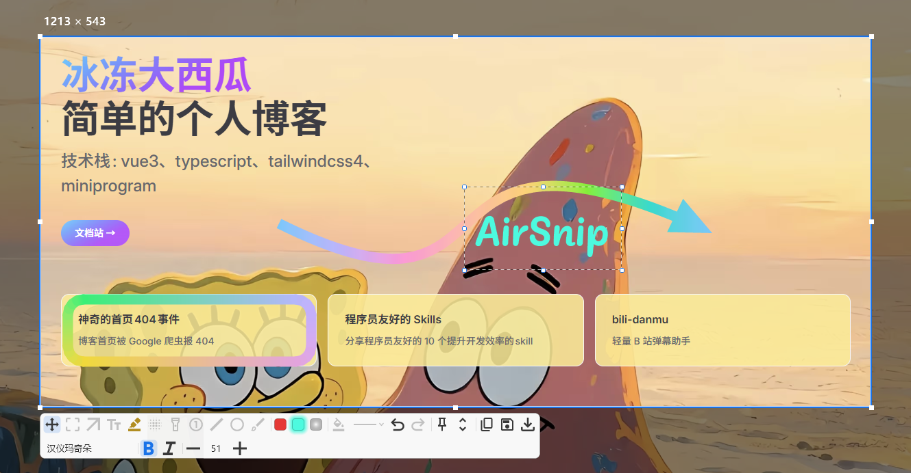

<div align="center">

# AirSnip

### A Windows screenshot & annotation tool in under 2 MB

**Zero idle CPU, single-digit MB resident memory, hotkey-to-screen in about 0.1 s — with annotation, re-editing, long screenshots, pin-to-screen and multi-format export.**

<p align="center">
  <a href="https://github.com/bd-dxg/airsnip/releases"></a>
  <a href="https://github.com/bd-dxg/airsnip/releases"></a>
  <a href="https://github.com/bd-dxg/airsnip/stargazers"></a>
  <a href="https://github.com/bd-dxg/airsnip/releases"></a>
  
  <a href="https://www.rust-lang.org/"></a>
  <a href="LICENSE"></a>
</p>

**[中文](README.md) · English**

**[Download](#download--install) · [Quick start](#quick-start) · [Features](#features) · [Shortcuts](#shortcuts) · [FAQ](#faq)**

</div>



*What you get after pressing `F1`: the screen freezes, you drag a region, and the bottom row holds every annotation tool. A selected rectangle is shown here (it can be dragged, recoloured, deleted), plus an arrow.*

## Why AirSnip?

Screenshot tools usually force a choice: an Electron wrapper that ships tens or hundreds of MB and idles at hundreds of MB of RAM, or a lightweight tool that only does region + arrow, so fixing a mistake means taking the screenshot again.

**AirSnip** tries to have both: a single exe under 2 MB with annotation that matches the big apps, rendered entirely on the CPU.

> CPU-only rendering. No GPU, no Electron, no runtime to install. One portable exe, just as smooth on a mini PC with integrated graphics, in a VM, or over remote desktop.

| | AirSnip | Typical Electron / runtime-based tools |
|:--|:--|:--|
| Size | **Single file under 2 MB** | Tens to hundreds of MB |
| Idle memory | **Around 1 MB** | Hundreds of MB |
| Idle CPU | **0%** (event-driven, no polling timers) | A resident process that keeps working |
| Runtime deps | **None** (statically linked CRT, no VC++ Redistributable) | Electron / WebView2 / .NET |
| GPU | **Not required** | Often needs GPU compositing |
| Install | **Unzip and run; delete it and it's gone** | Usually an installer that writes to the registry |
| Privacy | **Fully local**: no network, no uploads, no telemetry | Depends |

- **10 annotation tools** — rectangle, arrow, text, highlighter, blur, spotlight, numbered badge, line, ellipse, freehand, plus stroke styles, gradients and rounded corners
- **Fix it instead of redoing it** — recolour, resize, refont, fill any selected object; 100-step undo; `Del` removes only the selected annotation
- **Long screenshots and pinning** — manual-scroll stitching (with header/footer detection), then `F3` to pin the result on screen for reference
- **Fast enough to feel instant** — hotkey to usable overlay in ≤ 150 ms, redraw while dragging at ≥ 60 FPS
- **Configurable** — hide individual toolbar elements, rebind every shortcut (with conflict detection), path templates for quick save
- **The system-level details** — window and control-level snapping, IME candidate window following the caret, negative multi-monitor coordinates, mixed HDR/SDR

### Performance targets

| Metric | Target | Notes |
|---|---|---|
| **Size** | **Single file under 2 MB** | Portable; one exe is everything (the zip is smaller) |
| **Idle memory** | **< 5 MB** | Private Working Set while sitting in the tray (measured around 1 MB) |
| **Idle CPU** | **0%** | Event-driven, no polling: nothing is spent when you are not capturing |
| **Hotkey → usable overlay** | **≤ 150 ms** | 2560×1440: capture + dim + overlay ready |
| **Redraw while dragging** | **≥ 60 FPS** | A few ms per frame against a 16.7 ms budget |

> During a capture session the app allocates bitmaps sized to your screen (about 15 MB at 1440p) and frees them as soon as the overlay closes. Figures above are upper bounds, not per-release numbers; measurements are in `docs/perf-m5.md`.

**Why it stays small:** no Electron, no WebView, no .NET runtime. The UI and annotations are drawn by Rust directly (tiny-skia for vector rasterisation, DirectWrite for text), screen capture goes through GDI BitBlt, and the resident part only waits for a hotkey.

## Who it is for

- **People who screenshot for docs and bug reports** — hotkey, annotate, paste. No big app to open.
- **Old machines, mini PCs, VMs, remote desktops** — no GPU, low memory, auto-start that stays invisible.
- **People who hate installing things** — one exe, delete it and nothing is left behind (auto-start uses Task Scheduler, not the registry).
- **People who care about privacy** — everything is local. No network, no uploads, no telemetry.

## Download & install

### Official download channels

**AirSnip is free, forever — there is no paid or "pro" edition.** Only these two are official:

| Channel | Address |
| --- | --- |
| Website | <https://airsnip.bddxg.top> |
| GitHub Releases | <https://github.com/bd-dxg/airsnip/releases> |

Packages from file-hosting sites, chat groups or download portals are not official: they may be bundled with ads or malware, and they lose the signed auto-update protection. **If you paid for AirSnip somewhere else, ask that seller for a refund first, then get it free from the website** (Settings → About → website also opens it).

Licensed under GPL-3.0, which permits verbatim redistribution (including for a fee) but not closed-source modification or stripping the copyright notice. If you run into such a case, please open an [issue](https://github.com/bd-dxg/airsnip/issues).

**Requirements:** Windows 10 or later, 64-bit (tested on Windows 11; x64 builds only). Windows 7 / 8 / 8.1 cannot run it — the exe statically imports `WaitOnAddress`, `GetDpiForMonitor` and `GetDpiForWindow`, which do not exist there, so the loader rejects it before any code runs. Details and the import list are in [#94](https://github.com/bd-dxg/airsnip/issues/94).

1. Download `airsnip-v*-win-x64.zip` from [Releases](https://github.com/bd-dxg/airsnip/releases) and unzip it anywhere.
2. Run `airsnip.exe`. It **requires administrator rights** (otherwise it cannot capture elevated windows), so accept the UAC prompt on first launch.
3. It lives in the tray (no main window): press `F1` to capture, `F3` to pin. Left-click the tray icon for settings, right-click for the menu.
4. Config lives in `%APPDATA%\airsnip\config.toml`.

**Auto-update:** three seconds after launch it silently checks for a new version (can be turned off in Settings → About). When one is found a tray balloon appears; Settings → About → Version downloads and replaces the exe, then restarts. Manifests and packages go through mirrors first with a direct GitHub fallback, and are ed25519-signed plus SHA-256 verified.

**SmartScreen:** the exe is not code-signed, so Windows may show "Windows protected your PC". Choose *More info* → *Run anyway*.

## Quick start

1. Press `F1`. The screen freezes; drag to select a region. After you release, the app is in **move-selection** mode, so you can drag the region around without drawing anything.
2. Pick a tool from the toolbar or press `1`–`9` / `0` to annotate. `Shift` constrains direction and proportions; the wheel changes stroke width, font size or blur strength.
3. `Enter` copies to the clipboard, `Alt+S` saves straight to disk using your path template, `Ctrl+S` opens Save As.
4. `F3` pins the result on screen for side-by-side reference; `S` starts a long screenshot (scroll the page yourself, then `Enter` to finish).

## Features

### Capture

- `F1` freezes the whole desktop, then you drag a region (8-way resize, arrow keys nudge by 1 px / `Shift` 5 px).
- **After selecting, you are in move-selection mode** — dragging inside the region moves it (annotations follow) instead of drawing a rectangle. Pick a tool (or press `1`–`0`) to annotate; press `V` or click *Move* to go back.
- Double-clicking empty space inside the region finishes and copies (configurable to pin instead).
- **Window snapping**: with no selection, the window under the cursor is highlighted and a single click selects it whole; one level deeper is UI-element capture, and the wheel walks up and down that hierarchy.
- `Shift+F1` during a capture is **recapture**: the current screen (toolbar, selection and annotations included) becomes the new base image. It exists so you can screenshot AirSnip itself. Existing annotations become pixels and are no longer editable.
- Multi-monitor layouts with negative coordinates work (Per-Monitor V2 aware).

### Annotation (10 tools)

The first toolbar button is **Move** (pointer) — the default state after selecting. Clicking any other button (or pressing a number key) enters drawing mode.

| Tool | What it does |
|---|---|
| Rectangle | Stroke colour, width, **stroke style** (solid / dashed / dash-dot), fill, **rounded corners** |
| Arrow | Straight or curved (cubic Bézier), head scales with width; `Shift` snaps to horizontal / vertical / 45° |
| Text | Full IME support, every installed font, bold / italic, size; double-click to edit again |
| Highlighter | Multiply-blended translucent colour that keeps the text underneath readable |
| Blur | Drag a region to blur it; the wheel adjusts strength |
| Spotlight | Dims the whole selection and restores brightness where you draw; stackable |
| Numbered badge | Click to drop a circular badge (1, 2, 3… auto-incrementing, or ✓ / ✕) with a leader line; double-click to change it |
| Line | Plain line, no head; `Shift` snaps to horizontal / vertical / 45° |
| Ellipse | Drag its bounding box; fillable; `Shift` for a circle |
| Freehand | Draw freely; points are smoothed with Béziers; colour and width adjustable |

Curved arrows: select one and drag the handles at 1/3 and 2/3 to pull out an S-curve; double-click to straighten it.
Rectangles, highlighter, blur and spotlight all support **rounded corners** — drag the small circle inside the top-right of the bounding box.

### Re-editing

- Selecting an object shows its bounding box and 8 handles: drag to move, drag a corner to scale (`Shift` keeps proportions).
- In drawing mode, hold `Ctrl` and drag an object (or its bounding-box edge) to move it; in move-selection mode just drag.
- Moving or resizing the region keeps annotations in place relative to the screen; scaling handles only change what is cropped.
- `Del` / `Backspace` deletes just the selected annotation; one `Ctrl+Z` brings it back without touching anything else.
- Hovering a toolbar button for about 0.4 s shows a "name · shortcut" tooltip that follows your rebinds.
- **Gradients**: the third swatch is a gradient — click to use it, double-click for another set. Every new object advances to the next set, so consecutive annotations stay visually distinct. Rectangle, arrow, line, ellipse, freehand and badges support it, dashed strokes included.
- Undo / redo for 100 steps; one drag is one step.

### Output

- Clipboard: `CF_DIB` plus a lazily rendered PNG, so pasting into chat apps and documents stays lossless.
- **Quick save**: `Alt+S` writes straight to disk using your path template — date / time / Unix-ms variables and `%VAR%` environment variables, PNG / JPEG / WebP, and a "number duplicates / overwrite" policy. A clickable toast appears afterwards; clicking it reveals the file in Explorer.
- Save As: PNG / JPEG / WebP (lossless), with the system dialog and the file name pre-filled from the same template.
- Remembers the last folder and format, so taking many screenshots in a row is not interrupted.

### Long screenshots

- Uses the current selection as the viewport; you scroll the page yourself, then `Enter` finishes. `Ctrl+Z` drops the last segment.
- Segments are matched by full-overlap consistency, with sticky headers and footers detected and not repeated.
- A live thumbnail of the stitched result is shown while you scroll.
- **Window half-transparency is not supported** (background opacity below 100%, e.g. Windows Terminal's 70% default): such content is composited by the system and the captured frames cannot be stitched. Set the opacity to 100% first (the "Acrylic material" switch does not matter) — see `docs/longshot-known-issues.md` for the measurements.

### Pin to screen

- `F3` pins the selection (annotations included) on top of everything for reference.
- Drag to move, wheel to scale, `Ctrl` + wheel for opacity, optional 1 px blue border, right-click menu.
- `Space` or the *Edit* menu item returns to annotation mode; the result is written back to the same pin.
- Up to 20 pins, closable all at once.

### Settings

- Custom-drawn panel that follows the system light / dark theme.
- **Toolbar page**: hide any element — move + 10 tools / 2 solid colours + gradient / fill, stroke style, undo, redo, font row / pin, long shot / copy, save. Hiding is purely visual: shortcuts and output still work (hide the Save button and `Ctrl+S` still saves).
- Start with Windows, rebind every shortcut (with conflict detection), pin position, double-click action, theme.
- **Save page**: quick-save path template with variable help and live preview, format, duplicate policy, whether to show a toast / also copy to the clipboard.
- **About**: version, licence, third-party notices, project link, feedback (copies environment info) and updates.
- **Language**: Simplified Chinese, Traditional Chinese, English or Japanese; follows the Windows UI language by default and applies immediately when changed.

## Shortcuts

In the capture overlay:

| Key | Action |
|---|---|
| `Enter` / `Ctrl+C` / double-click inside the region | Copy to the clipboard and exit (double-click can be set to pin instead) |
| `Ctrl+S` | Save As (PNG / JPEG / WebP) |
| `Alt+S` | Quick save using the path template, no dialog (rebindable) |
| `F3` | Pin the selection to the screen |
| `S` | Long screenshot, using the current selection as the viewport (rebindable) |
| `F` | Full screen: select the whole monitor under the cursor (when nothing is selected) |
| `R` | Last area: reuse the region you last confirmed in this session |
| `Shift+F1` | Recapture: use the current screen as the new base image |
| `V` | Back to move-selection mode |
| `1`–`9`, `0` | Switch tools (rectangle, arrow, text, highlighter, blur, spotlight, badge, line, ellipse, freehand) |
| `Ctrl+Z` / `Ctrl+Y`, `Ctrl+Shift+Z` | Undo / redo |
| `Del` / `Backspace` | Delete the selected annotation |
| Arrow keys (`Shift` ×5) | Nudge the selected object, or the region when nothing is selected |
| `Shift` + drag | Square / arrow direction snapping / axis lock / proportional scaling |
| Space + drag | Move the whole region |
| Wheel | Stroke width, blur strength or font size |
| `Esc` | Cancel the capture |

In a pinned window: drag to move, wheel to scale, `Ctrl` + wheel for opacity, double-click or `Esc` to close, right-click menu, `Ctrl+F3` toggles the border, arrow keys nudge.

Global hotkeys default to `F1` (capture) and `F3` (pin) and can be changed in Settings. Unmodified keys take the key away from other applications, so `Ctrl` / `Alt` combinations are recommended. Middle click and the two side buttons can also be bound (subscribed via Raw Input, so other apps are unaffected; mouse + modifier combinations are not supported).

## FAQ

<details>
<summary><strong>Why does it need administrator rights?</strong></summary>

To capture or interact with elevated windows it needs the same integrity level. Auto-start therefore uses Task Scheduler rather than a registry `Run` key. Accept the UAC prompt on first launch.
</details>

<details>
<summary><strong>Does it run on Windows 7 / 8 / 8.1?</strong></summary>

No, and it is not a missing feature — the exe is rejected at load time. It statically imports APIs that predate Windows 10 (`WaitOnAddress`, `GetDpiForMonitor`, `GetDpiForWindow`), which cannot be resolved lazily. See [#94](https://github.com/bd-dxg/airsnip/issues/94).
</details>

<details>
<summary><strong>SmartScreen says "Windows protected your PC".</strong></summary>

The exe is not code-signed. Choose *More info* → *Run anyway*.
</details>

<details>
<summary><strong>Some windows capture as black.</strong></summary>

Exclusive full-screen games and DRM-protected content cannot be captured — that is a system restriction, not something the app can work around.
</details>

<details>
<summary><strong>Multi-monitor, mixed DPI and HDR?</strong></summary>

Single-monitor and negative-coordinate multi-monitor setups are tested; the mixed HDR + SDR black-screen bug is fixed (ADR 0024). **Mixed DPI has not been verified on real hardware** yet (no such machine available), so reports are welcome.
</details>

<details>
<summary><strong>The right end of the toolbar is cut off.</strong></summary>

In extreme combinations (for example 1366×768 at 200% UI scale) the toolbar can be wider than the screen. Hide the elements you do not use on Settings → Toolbar; shortcuts keep working either way (ADR 0033).
</details>

<details>
<summary><strong>Does it phone home or upload my screenshots?</strong></summary>

No. Capturing and annotating are entirely local: no uploads, no telemetry. The only outbound request is the update check at startup, which can be turned off in Settings → About.
</details>

<details>
<summary><strong>Which languages does the UI support?</strong></summary>

Simplified Chinese, Traditional Chinese, English and Japanese. It follows the Windows UI language by default (English on any non-Chinese system), and you can pick one in Settings → General → Language — the change applies immediately. Coverage is being extended batch by batch: the settings panel and the capture overlay are done, long-screenshot and tray strings are still in progress (ADR 0047).
</details>

<details>
<summary><strong>Upgrading from the old <code>jietu</code> name (v0.5.0 and earlier)?</strong></summary>

There is no automatic migration. Do three things manually:

1. Delete the old auto-start task (elevated PowerShell): `schtasks /delete /tn jietu /f`
2. Quit and delete the old `jietu.exe` — the two versions do not exclude each other and will fight over the same hotkeys
3. Re-create your settings (the new file is `%APPDATA%\airsnip\config.toml`); old screenshots stay in `Pictures\jietu`
</details>

## Build

```powershell
cargo run                 # dev build (not elevated, easy to debug)
cargo build --release     # release build (manifest requires admin, single file)
cargo test                # unit tests (a few --ignored integration tests need manual setup)
cargo fmt --check
cargo deny check          # licences, advisories, sources
pwsh scripts/package.ps1  # dist\airsnip-v{version}-win-x64.zip and the auto-update .exe
pwsh scripts/gen-latest-json.ps1 -Notes "notes"  # sign and emit latest.json
```

**Stack:** Rust 1.98 (edition 2024) · windows-rs 0.62 · tiny-skia 0.12 (vector rasterisation) · DirectWrite (text) · serde / toml · png / jpeg-encoder / image-webp. The MSVC runtime is **statically linked**, so the exe does not need the VC++ Redistributable. Current version: v0.14.0.

Issues and PRs are welcome. Please open an issue to discuss an approach before writing code, and make sure `cargo fmt --check`, `cargo test` and `cargo deny check` pass. Module layout, file-size limits and documentation conventions are in `AGENTS.md` (Chinese).

## Docs

- `screenshot-tool-PRD.md` — full requirements and technical design (Chinese)
- `docs/adr/` — architecture decision records (Chinese)
- `docs/release-notes/` — per-release notes (Chinese)
- `docs/perf-m5.md` — performance measurements (Chinese)
- `AGENTS.md` — development conventions and milestones (Chinese)
- `THIRD-PARTY.md` — third-party notices

## License

[GPL-3.0-only](LICENSE). Every source file carries an SPDX header; dependencies are permissively licensed (MIT / Apache-2.0 / BSD / Zlib / IJG and similar), compatible with GPL-3.0.

Website (Chinese): **[airsnip.bddxg.top](https://airsnip.bddxg.top)**
