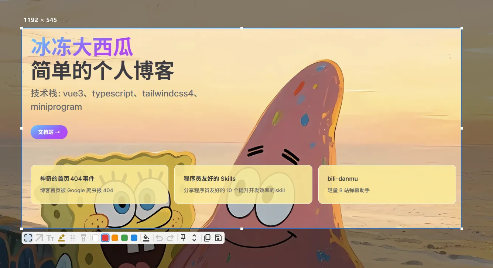

# AirSnip（轻截）

**1 MB 的 Windows 截图标注工具。** 常驻内存 1.2 MB、待机 0% CPU、按热键 0.12 秒出画面——
标注、二次编辑、长截图、贴图、多格式另存，功能一样不少。

> 纯 CPU 渲染，不依赖 GPU、不套 Electron、不装运行时。解压即用的绿色单文件，在核显迷你主机、虚拟机、远程桌面里同样流畅。



*按 `F1` 后的样子：屏幕冻结、框选任意区域，底部一行就是全部标注工具。*

## 几个关键数字

| 指标 | 实测 | 说明 |
|---|---|---|
| **单文件体积** | **1.06 MB** | 绿色免安装，一个 exe 就是全部 |
| **下载包** | **0.61 MB** | zip，含文档与许可证 |
| **待机内存** | **1.2 MB** | 常驻托盘时的 Private Working Set |
| **待机 CPU** | **0.00%** | 事件驱动，无定时轮询 |
| **热键 → 可用画面** | **124 ms** | 2560×1440：全屏抓取 + 暗化 + 覆盖层就绪 |
| **拖框重绘** | **4.6 ms / 帧** | 60 FPS 红线 16.7 ms，留有 3 倍余量 |

> 截图会话期间会按屏幕大小临时分配位图（1440p 约 15 MB），退出覆盖层立即释放——不截图时它几乎不占资源。
> 数据来自真实目标机型（无独显）实测，方法与优化过程见 `docs/perf-m5.md`。

**为什么能这么小：** 没有 Electron / WebView / .NET 运行时，界面与标注全部由 Rust 直接绘制（tiny-skia 矢量栅格化 + DirectWrite 文字），抓屏走 GDI BitBlt，常驻部分只做「等热键」一件事。不少同类工具自带运行时或基于 Electron，安装包在数十至上百 MB、常驻内存数百 MB 量级——AirSnip 把这两项都压到了 1 MB 量级。

## 适合谁

- **经常截图写文档 / 提 bug 的人**：热键即出、标完直接粘，不用开大软件
- **老机器 / 迷你主机 / 虚拟机 / 远程桌面**：不靠 GPU、不吃内存，开机自启无感
- **不喜欢装东西的人**：一个 exe，删了就卸载干净，不写注册表（自启走任务计划）
- **在意隐私的人**：本地处理，不联网、不上传、无遥测

## 功能

### 截图
- `F1` 触发：全屏冻结 → 框选（八向缩放、按住空格整体拖动、方向键 1px 微调 / `Shift` 5px）
- 选区内空白处双击 = 复制完成，一步到位
- 多显示器与负坐标布局正确（Per-Monitor V2 感知；混合 DPI 见「已知限制」）

### 标注（6 个工具，箭头支持直线与曲线）
| 工具 | 能做什么 |
|---|---|
| 矩形 | 描边颜色、线宽、填充、**圆角** |
| 箭头 | 直线或曲线（三次贝塞尔），头部随线宽缩放；`Shift` 吸附水平 / 垂直 / 45° |
| 文本 | 中文输入法、系统全部字体、粗体 / 斜体、字号，双击再编辑 |
| 荧光笔 | 正片叠底半透明色块，不遮挡底图文字 |
| 高斯模糊 | 拖动区域即模糊，强度滚轮可调 |
| 聚光灯 | 选区内整体暗化、绘制区域恢复原亮，可叠加多块 |

曲线箭头：选中后 1/3、2/3 处出现控制柄，拖出 S 形，双击恢复直线。
矩形、荧光笔、模糊、聚光灯都支持**圆角**：拖包围框内侧角的小圆柄即可，所见即所得。

### 二次编辑
- 选中对象显示包围框 + 八向手柄：拖动移动、拖角缩放（`Shift` 等比）
- 颜色与填充实时作用于选中对象，不用重画；线宽 / 模糊强度 / 字号用滚轮调，同样作用于选中对象
- `Shift` 约束：新建时正方形、箭头方向吸附，编辑时轴向锁定、等比缩放
- 撤销 / 重做 100 步，一次拖拽 = 一步，误操作随手回退

### 输出
- 剪贴板：`CF_DIB` + 延迟渲染 PNG，粘到微信 / 文档 / 聊天框都不失真
- 另存为：PNG / JPEG / WebP（无损），弹出系统对话框自选路径与格式
- 文件名模板：`airsnip-20241231-235959` / 时间戳 / 仅日期；记住上次目录与格式，连拍不打断

### 长截图
- 以当前选区为视口，自己滚动页面、`Enter` 收尾，`Ctrl+Z` 可撤销最后一段
- 全重叠区一致性校验拼接，自动识别固定页眉 / 页脚不重复
- 拼接过程实时缩略预览，滚到哪看到哪

### 贴图（Pin）
- `F3` 把选区（含标注）钉在屏幕上，随时对照
- 拖动、滚轮缩放、`Ctrl`+滚轮调透明度、1px 蓝框、右键菜单
- 最多 20 张，可一键全部关闭

### 设置
- 自绘面板，跟随系统深浅色
- 开机自启、全部快捷键改键（含冲突检测与输入法兼容）
- 贴图默认位置、文件名模板、主题
- 「关于」页：版本、许可、第三方组件清单、项目地址

## 快捷键

截图界面（覆盖层）：

| 按键 | 动作 |
|---|---|
| `Enter` / `Ctrl+C` / 选区内双击 | 复制到剪贴板并退出 |
| `Ctrl+S` | 另存为（PNG / JPEG / WebP） |
| `F3` | 把选区贴到屏幕 |
| `S` | 长截图（当前选区为视口） |
| `1`–`6` | 切换工具（矩形 / 箭头 / 文本 / 荧光笔 / 模糊 / 聚光灯，可改） |
| `Ctrl+Z` / `Ctrl+Y` · `Ctrl+Shift+Z` | 撤销 / 重做 |
| 方向键（`Shift` ×5） | 微调选中对象；无选中时移动选区框 |
| `Shift` + 拖动 | 正方形 / 箭头方向吸附 / 轴向锁定 / 等比缩放 |
| 按住空格 + 拖动 | 移动整个选区 |
| 滚轮 | 调线宽 / 模糊强度 / 字号（悬停对象或空白处） |
| `Esc` | 取消截图 |

贴图窗口：左键拖动、滚轮缩放、`Ctrl`+滚轮透明度、双击 / `Esc` 关闭、右键菜单、`Ctrl+F3` 边框开关、方向键移动。

全局热键默认 `F1` 截图、`F3` 贴图，可在设置面板修改；无修饰键会抢占其他程序按键，建议用 `Ctrl` / `Alt` 组合。

## 下载与使用

1. 从 [Releases](https://github.com/bd-dxg/airsnip/releases) 下载 `airsnip-v*-win-x64.zip`，解压到任意目录（绿色单文件，无需安装）
2. 双击 `airsnip.exe`：程序**需要管理员权限**（否则无法覆盖管理员权限的窗口，见 ADR 0003），首次运行会弹 UAC，请选「是」
3. 启动后托盘常驻（无主窗口），按 `F1` 截图 / `F3` 贴图
4. 托盘左键打开设置，右键为「设置 / 退出」
5. 配置位置：`%APPDATA%\airsnip\config.toml`

**自动更新**：启动后 3 秒静默检查一次新版本（可在设置 → 关于页关闭），发现新版本时弹托盘气泡提示；到「关于 → 版本更新」点一下即可下载并自动替换重启。清单与安装包优先走国内加速镜像，GitHub 直连兜底；清单用 ed25519 签名 + SHA-256 校验，验签不过不会安装。

**首次运行提示**：exe 未做代码签名，Windows SmartScreen 可能提示「已保护你的电脑」——点「更多信息」→「仍要运行」。

**从旧版 `jietu`（v0.5.0 及更早）升级**：本版改名为 AirSnip，**不做自动迁移**，请手动完成三件事——
1. 删除旧的开机自启任务（管理员 PowerShell）：`schtasks /delete /tn jietu /f`
2. 退出并删除旧版 `jietu.exe`：新旧版的单实例互不排斥，同时运行会抢同一组热键
3. 设置需重设一次（新配置在 `%APPDATA%\airsnip\config.toml`）；旧截图仍在 `图片\jietu`，不会自动搬家

## 构建与开发

```powershell
cargo run                 # 开发版（不提权，可调试）
cargo build --release     # 发布版（manifest 要求管理员权限，单文件）
cargo test                # 单测（216 项）
cargo fmt --check         # 格式化检查
cargo deny check          # 依赖许可证 / 安全公告 / 来源检查
pwsh scripts/package.ps1  # 打包 dist\airsnip-v{版本}-win-x64.zip / .exe
pwsh scripts/gen-latest-json.ps1 -Notes "说明"  # 生成并签名自动更新清单 latest.json
```

技术栈：Rust 1.98（edition 2024）、windows-rs 0.62、tiny-skia 0.12（矢量栅格化）、DirectWrite（文字）、serde / toml、png / jpeg-encoder / image-webp。当前版本 v0.6.0。

## 已知限制

- 发布版以管理员权限运行（覆盖 / 操作管理员窗口需要，见 ADR 0003）；开机自启走任务计划而非注册表
- 独占全屏游戏、DRM 保护内容可能抓到黑屏（系统限制，非本程序可绕过）
- 界面仅简体中文，代码层预留 i18n
- 多屏混合 DPI 尚未在实机验证（无环境）；单屏与负坐标多屏已实测正常

## 文档

- `screenshot-tool-PRD.md` — 完整需求与技术方案（性能红线、风险对策）
- `docs/adr/` — 架构决策记录
- `docs/perf-m5.md` — 性能实测数据与优化过程
- `THIRD-PARTY.md` — 第三方组件声明
- `Task/task_plan.md` · `Task/progress.md` · `Task/findings.md` — 开发计划、会话进度、技术踩坑

## 许可

[GPL-3.0-only](LICENSE)。源文件均带 SPDX 标注；依赖均为宽松许可证（MIT / Apache-2.0 / BSD / Zlib / IJG 等），与 GPL-3.0 兼容。

感谢 [LinuxDo](https://linux.do/) 社区
