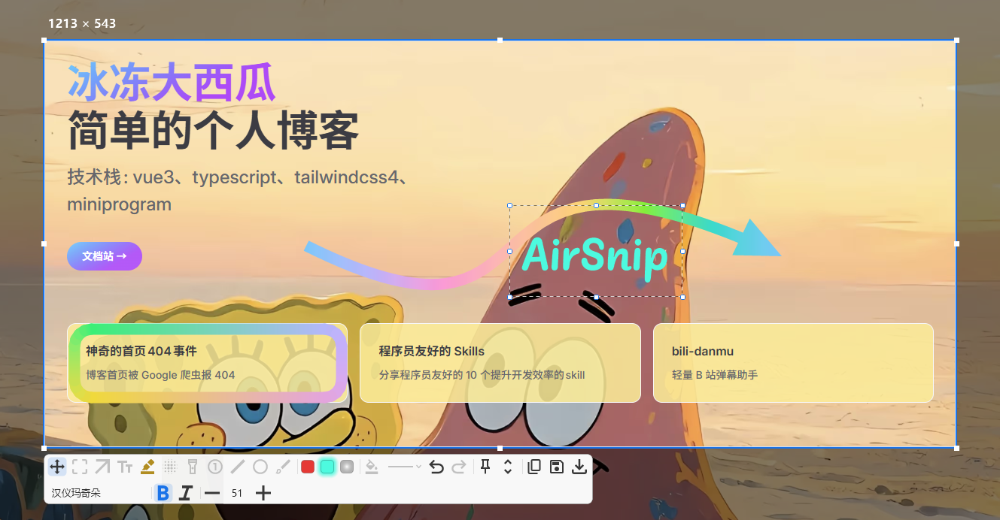

<div align="center">

# AirSnip（轻截）

### 2 MB 以内的 Windows 截图标注工具

**待机不占 CPU、常驻内存个位数 MB、按热键 0.1 秒级出画面——标注、二次编辑、长截图、贴图、多格式另存，功能一样不少。**

<p align="center">
  <a href="https://github.com/bd-dxg/airsnip/releases"></a>
  <a href="https://github.com/bd-dxg/airsnip/releases"></a>
  <a href="https://github.com/bd-dxg/airsnip/stargazers"></a>
  <a href="https://github.com/bd-dxg/airsnip/releases"></a>
  
  <a href="https://www.rust-lang.org/"></a>
  <a href="LICENSE"></a>
</p>

### 🌐 官网：**[airsnip.bddxg.top](https://airsnip.bddxg.top)**

**中文** · [English](README.en.md)

**[下载与安装](#下载与安装) · [快速上手](#快速上手) · [功能](#功能) · [快捷键](#快捷键) · [常见问题](#常见问题) · [技术文档](#技术文档)**

</div>



*按 `F1` 后的样子：屏幕冻结、框选区域，底部一行就是全部标注工具。图中选中了一个矩形标注（可拖动 / 改色 / 删除），另有一条箭头。*

## ❤️ 赞助支持

> 想出现在这里？赞助时注明名字即可。

<details open>
<summary>展开 / 收起赞助名单</summary>

<br>

<table>
<tr>
<td width="230" align="center"></td>
<td>感谢 <b>墨析AI公益站</b> 赞助本项目 <b>¥125</b>——这是 AirSnip 收到的第一笔赞助。</td>
</tr>
</table>

AirSnip 免费、开源、无广告、无内购，也没有商业化计划。开发和维护都在业余时间完成——如果它替你省下过时间，可以扫码请我喝杯咖啡，收到的每一份支持都会记在这里（累计 **¥125**）。

<p align="center"></p>
<p align="center"><sub>微信扫码赞赏 · 金额随意</sub></p>

</details>

## 为什么选 AirSnip？

截图工具不缺，但常常二选一：装个 Electron 套壳，几十上百 MB、常驻几百 MB 内存；或者用轻量小工具，只有框选 + 箭头，标完想改一下得重新截。

**AirSnip** 想两头都占：一个 2 MB 以内的 exe，标注能力对标大软件，并且纯本地、纯 CPU。

> 纯 CPU 渲染，不依赖 GPU、不套 Electron、不装运行时。解压即用的绿色单文件，在核显迷你主机、虚拟机、远程桌面里同样流畅。

| 维度 | AirSnip | 常见 Electron / 带运行时的截图工具 |
|:--|:--|:--|
| 体积 | **单文件 < 2 MB** | 数十至上百 MB |
| 待机内存 | **1 MB 量级** | 数百 MB |
| 待机 CPU | **0%**（事件驱动，无定时轮询） | 常驻进程持续占用 |
| 运行时依赖 | **无**（静态链接 CRT，不装 VC++ 运行库） | Electron / WebView2 / .NET |
| GPU | **不需要** | 部分依赖 GPU 合成 |
| 安装 | **解压即用，删了就是卸载干净** | 通常需要安装器、写注册表 |
| 隐私 | **全本地**：不联网、不上传、无遥测 | 视实现 |

- **10 个标注工具** —— 矩形 / 箭头 / 文本 / 荧光笔 / 高斯模糊 / 聚光灯 / 徽标序号 / 直线 / 椭圆 / 手绘，外加线型、渐变、圆角
- **标错了不用重来** —— 选中对象改颜色 / 线宽 / 字号 / 填充，撤销重做 100 步，`Del` 只删选中的那一个标注
- **长截图与贴图** —— 手动滚动拼接（自动识别固定页眉页脚），`F3` 把结果钉在屏幕上对照
- **快到无感** —— 热键到可用画面 ≤ 150 ms，拖框重绘 ≥ 60 FPS
- **可配到顺手** —— 工具栏逐元素显隐、全部快捷键可改（带冲突检测）、快速保存路径模板
- **系统级细节到位** —— 窗口吸附与控件级捕捉、中文输入法候选框跟随光标、多显示器负坐标、混合 HDR/SDR

### 性能红线（上限口径）

| 指标 | 表现 | 说明 |
|---|---|---|
| **体积** | **单文件 < 2 MB** | 绿色免安装，一个 exe 就是全部（zip 包更小） |
| **待机内存** | **< 5 MB** | 常驻托盘时的 Private Working Set（实测 1 MB 量级） |
| **待机 CPU** | **0%** | 事件驱动、无定时轮询，不截图时完全不占 CPU |
| **热键 → 可用画面** | **≤ 150 ms** | 2560×1440：抓屏 + 暗化 + 覆盖层就绪（0.1 秒级） |
| **拖框重绘** | **≥ 60 FPS** | 每帧个位数毫秒，16.7 ms 预算留有多倍余量 |

> 截图会话期间会按屏幕大小临时分配位图（1440p 约 15 MB），退出覆盖层立即释放——不截图时它几乎不占资源。以上为上限口径（不会随每次发版漂移）；精确数值与测量方法见 `docs/perf-m5.md`。

**为什么能这么小：** 没有 Electron / WebView / .NET 运行时，界面与标注全部由 Rust 直接绘制（tiny-skia 矢量栅格化 + DirectWrite 文字），抓屏走 GDI BitBlt，常驻部分只做「等热键」一件事。不少同类工具自带运行时或基于 Electron，安装包在数十至上百 MB、常驻内存数百 MB 量级——AirSnip 把安装包压到 2 MB 以内、常驻内存压到 1 MB 量级。

## 适合谁

- **经常截图写文档 / 提 bug 的人**：热键即出、标完直接粘，不用开大软件
- **老机器 / 迷你主机 / 虚拟机 / 远程桌面**：不靠 GPU、不吃内存，开机自启无感
- **不喜欢装东西的人**：一个 exe，删了就卸载干净，不写注册表（自启走任务计划）
- **在意隐私的人**：本地处理，不联网、不上传、无遥测

## 影响力

一个人业余维护，没有推广预算，没投过广告，也没做过任何形式的运营——用户基本都是口口相传来的：

| 指标 | 现在 |
|---|---|
| GitHub Star | **600+**（顶部徽章实时显示） |
| Fork / 二次开发 | **59** |
| Release 安装包下载 | **6,000+ 次** |
| 社区 | 首发于 [LinuxDo](https://linux.do/)，官网 [airsnip.bddxg.top](https://airsnip.bddxg.top) |

> 下载量只算 exe / zip 附件，**不含**自动更新清单 `latest.json` 的请求——每台机器启动检查更新时都会拉一次，会把数字虚高一倍多。表格与徽章数字随发版手动更新。

一个没有商业化的个人项目能走到这一步，靠的是愿意接受「一个人 + 业余时间」节奏的用户。所有取舍都摊在仓库里：决策记录（`docs/adr/`）、需求（`screenshot-tool-PRD.md`）、性能实测（`docs/perf-m5.md`）全部公开，连「做了什么又撤了」也留档（例如撤销 OCR / 翻译，见 ADR 0035）。

<div align="center">

### Star 增长

<a href="https://www.star-history.com/?repos=bd-dxg%2Fairsnip&type=date&releases=&legend=bottom-right">
 <picture>
   <source media="(prefers-color-scheme: dark)" srcset="https://api.star-history.com/chart?repos=bd-dxg/airsnip&type=date&theme=dark&legend=bottom-right" />
   <source media="(prefers-color-scheme: light)" srcset="https://api.star-history.com/chart?repos=bd-dxg/airsnip&type=date&legend=bottom-right" />
   
 </picture>
</a>

</div>

## 下载与安装

### 系统要求

- **Windows 10 及以上（64 位）**；Windows 11 已实测。只提供 x64 构建。
- **Windows 7 / 8 / 8.1 无法运行**，且不是功能缺失——exe 在加载阶段就会被系统拒绝，双击后通常弹「无法定位程序输入点 WaitOnAddress 于动态链接库 KERNEL32.dll 上」或被提示缺少 `api-ms-win-core-synch-l1-2-0.dll`，进程起不来。

  原因：程序静态导入了 Windows 10 之前不存在的系统 API——`WaitOnAddress`（Windows 8 引入，Rust 标准库从 1.78 起用它做锁）、`GetDpiForMonitor`（8.1）、`GetDpiForWindow`（10 1607）。这些是导入表里的必解析项，无法运行时降级；要在 Win7 上跑需要自行编译 Rust 标准库（tier-3 目标 `x86_64-win7-windows-msvc`），本项目不做这个取舍。完整原因与导入项清单见 [#94](https://github.com/bd-dxg/airsnip/issues/94)。

### 安装

1. 从 [Releases](https://github.com/bd-dxg/airsnip/releases) 下载 `airsnip-v*-win-x64.zip`，解压到任意目录（绿色单文件，无需安装）
2. 双击 `airsnip.exe`：程序按**当前账户的最高可达权限**运行（manifest `highestAvailable`，见 ADR 0048）——管理员账户会弹 UAC，选「是」即可完整使用（能截取管理员权限的窗口）；标准账户不提权、不弹框，直接以普通权限运行，代价是截不到以管理员身份运行的程序窗口（启动时会弹一次托盘气泡说明）
3. 启动后托盘常驻（无主窗口），按 `F1` 截图 / `F3` 贴图；托盘左键打开设置，右键为「设置 / 退出」
4. 配置位置：`%APPDATA%\airsnip\config.toml`

**自动更新**：启动后 3 秒静默检查一次新版本（可在设置 → 关于页关闭），发现新版本时弹托盘气泡提示；到「关于 → 版本更新」点一下即可下载并自动替换重启。清单与安装包优先走国内加速镜像，GitHub 直连兜底；清单用 ed25519 签名 + SHA-256 校验，验签不过不会安装。

**首次运行提示**：exe 未做代码签名，Windows SmartScreen 可能提示「已保护你的电脑」——点「更多信息」→「仍要运行」。

## 快速上手

1. 按 `F1`：屏幕冻结，拖动框选区域（松手后默认是「移动选区」态，可以直接拖框挪位置）
2. 点工具栏的工具或按数字键 `1`–`9` / `0` 开始标注；`Shift` 约束方向 / 等比，滚轮调线宽 / 字号 / 模糊强度
3. `Enter` 复制到剪贴板，`Alt+S` 按模板直接落盘，`Ctrl+S` 另存为
4. `F3` 把结果贴到屏幕上对照；`S` 长截图（自己滚动页面后 `Enter` 收尾）

## 功能

### 截图
- `F1` 触发：全屏冻结 → 框选（八向缩放、方向键 1px 微调 / `Shift` 5px）
- **框选完成后默认是「移动选区」**：在选区内拖动就是整体挪框（标注跟着走），不会误画出矩形；要画标注先点工具栏的工具（或按 `1`–`0`），画完想回去挪框点「移动」或按 `V`
- 选区内空白处双击 = 复制完成，一步到位（可在设置里改成「贴到屏幕」）
- **窗口吸附**：没有选区时，光标停在哪就高亮哪个窗口，单击即整窗选定；再往下一层是 UI 元素级捕捉，滚轮上 / 下切换层级
- 截图过程中按 `Shift+F1` = **再次截图**：当前画面（含工具栏、选区与已有标注）当作新底图重新框选，用来截 AirSnip 自己的界面；该键只在截图期间生效，可在设置面板改。注意：已有的标注会被拍进新底图变成像素，不再可编辑（不可撤销）
- 多显示器与负坐标布局正确（Per-Monitor V2 感知；混合 DPI 见「常见问题」）

### 标注（10 个工具，箭头支持直线与曲线）

工具栏第一个按钮是**移动**（指针）：框选完成后的默认态。点其它按钮（或按数字键）才进入绘制。

| 工具 | 能做什么 |
|---|---|
| 矩形 | 描边颜色、线宽、**线型**（实线 / 虚线 / 点划线）、填充、**圆角** |
| 箭头 | 直线或曲线（三次贝塞尔），头部随线宽缩放；`Shift` 吸附水平 / 垂直 / 45° |
| 文本 | 中文输入法、系统全部字体、粗体 / 斜体、字号，双击再编辑 |
| 荧光笔 | 正片叠底半透明色块，不遮挡底图文字 |
| 高斯模糊 | 拖动区域即模糊，强度滚轮可调 |
| 聚光灯 | 选区内整体暗化、绘制区域恢复原亮，可叠加多块 |
| 序号标记 | 按下放圆形徽标（1、2、3…自动递增，也可以是 ✓ / ✕），拖出箭头指向目标；双击徽标可改内容 |
| 直线 | 无箭头纯线段，`Shift` 吸附水平 / 垂直 / 45° |
| 椭圆 | 拖出外接矩形画椭圆，可填充，`Shift` 画正圆 |
| 手绘 | 按住鼠标自由涂画，点列贝塞尔平滑，颜色 / 线宽可调 |

曲线箭头：选中后 1/3、2/3 处出现控制柄，拖出 S 形，双击恢复直线。
矩形、荧光笔、模糊、聚光灯都支持**圆角**：拖包围框内侧角的小圆柄即可，所见即所得。

### 二次编辑
- 选中对象显示包围框 + 八向手柄：拖动移动、拖角缩放（`Shift` 等比）
- 绘制态下要挪已有标注：按住 `Ctrl` 拖对象本体，或拖它的包围框边缘；移动态下直接拖就行
- 平移选区（拖动或方向键）时标注一起跟随，拖手柄缩放只改裁剪范围
- 选中后按 `Del` / `Backspace` 只删这一个标注，`Ctrl+Z` 一步恢复，不连带撤销其它标注
- 鼠标在工具栏按钮上停约 0.4 秒，弹出「名称 · 快捷键」悬浮提示（改键后跟着变）
- 颜色与填充实时作用于选中对象，不用重画；线宽 / 模糊强度 / 字号用滚轮调，同样作用于选中对象；线型（实线 / 虚线 / 点划线）在工具栏下拉里切，同样实时作用于选中对象
- **渐变**：色块组第 3 格是渐变色块——单击用、双击换一套；每画一个新对象自动换一套（同色系沿色相环顺路前推，上一套终点接下一套起点，中间提亮，通透不显脏）。矩形 / 箭头 / 直线 / 椭圆 / 手绘 / 序号都支持，虚线渐变也能叠
- `Shift` 约束：新建时正方形、箭头方向吸附，编辑时轴向锁定、等比缩放
- 撤销 / 重做 100 步，一次拖拽 = 一步，误操作随手回退

### 输出
- 剪贴板：`CF_DIB` + 延迟渲染 PNG，粘到微信 / 文档 / 聊天框都不失真
- **快速保存**：`Alt+S` 一个键按路径模板直接落盘，不弹对话框；模板支持日期 / 时间 / Unix 毫秒变量与 `%VAR%` 环境变量，格式（PNG / JPEG / WebP）与「同名自动加序号 / 覆盖」可选；存完弹一条可点的轻提示（点了直接在资源管理器里定位文件）
- 另存为：PNG / JPEG / WebP（无损），弹出系统对话框自选路径与格式；文件名按同一份模板预填
- 记住上次目录与格式，连拍不打断

### 长截图
- 以当前选区为视口，自己滚动页面、`Enter` 收尾，`Ctrl+Z` 可撤销最后一段
- 全重叠区一致性校验拼接，自动识别固定页眉 / 页脚不重复
- 拼接过程实时缩略预览，滚到哪看到哪
- **不支持背景半透明的窗口**（背景不透明度 < 100%，如 Windows Terminal 默认 70%）：这类内容由系统合成，抓到的帧拼不起来，请先把不透明度调到 100%（「启用亚克力材料」开着不影响）；原因与实测数据见 `docs/longshot-known-issues.md`

### 贴图（Pin）
- `F3` 把选区（含标注）钉在屏幕上，随时对照
- 拖动、滚轮缩放、`Ctrl`+滚轮调透明度、1px 蓝框、右键菜单
- 空格或右键菜单「编辑」可回到标注态继续改，改完写回同一张贴图
- 最多 20 张，可一键全部关闭

### 设置
- 自绘面板，跟随系统深浅色
- **工具栏页**：把截图工具栏收成自己常用的那一小块——移动 + 10 个工具 / 2 个纯色 + 渐变 / 填充·线型·撤销·重做·字体行 / 贴图·长截图 / 复制·保存 逐项可隐，组头一键全显或全隐；隐藏只影响绘制，快捷键与输出照旧（藏了保存按钮，`Ctrl+S` 照样能存）
- 开机自启、全部快捷键改键（含冲突检测与输入法兼容）
- 贴图默认位置（原位置 / 屏幕中间）、双击选区空白的动作（复制 / 贴图）、主题
- **保存页**：快速保存的路径模板（带变量说明与实时预览）、格式、同名策略、保存后是否弹提示 / 是否同时复制剪贴板、一键打开 / 更改模板目录
- 「关于」页：版本、许可、第三方组件清单、项目地址、我要反馈（一键复制环境信息）、版本更新

## 快捷键

截图界面（覆盖层）：

| 按键 | 动作 |
|---|---|
| `Enter` / `Ctrl+C` / 选区内双击 | 复制到剪贴板并退出（双击可在设置里改为「贴到屏幕」） |
| `Ctrl+S` | 另存为（PNG / JPEG / WebP） |
| `Alt+S` | 快速保存：按路径模板直接落盘，不弹对话框（可改） |
| `F3` | 把选区贴到屏幕 |
| `S` | 长截图（当前选区为视口，可改） |
| `F` | 全屏：把鼠标所在那块显示器的整屏选上（无选区时生效，可改） |
| `R` | 上次区域：复用本次运行里上次框选的区域（无选区时生效，可改） |
| `Shift+F1` | 再次截图：把当前画面当作新底图重新框选（用于截取本软件界面，可改） |
| `V` | 回到「移动选区」态（可改）：拖选区内空白平移选区（标注跟随），拖对象移动该对象 |
| `1`–`9`、`0` | 切换工具（矩形 / 箭头 / 文本 / 荧光笔 / 模糊 / 聚光灯 / 序号 / 直线 / 椭圆 / 手绘，可改） |
| `Ctrl+Z` / `Ctrl+Y` · `Ctrl+Shift+Z` | 撤销 / 重做 |
| `Del` / `Backspace` | 删除选中的那个标注（一步撤销可恢复，不影响其它标注） |
| 方向键（`Shift` ×5） | 微调选中对象；无选中时移动选区框 |
| `Shift` + 拖动 | 正方形 / 箭头方向吸附 / 轴向锁定 / 等比缩放 |
| 按住空格 + 拖动 | 移动整个选区（移动态下直接拖即可，空格只是另一种按法） |
| 滚轮 | 调线宽 / 模糊强度 / 字号（悬停对象或空白处） |
| `Esc` | 取消截图 |

贴图窗口：左键拖动、滚轮缩放、`Ctrl`+滚轮透明度、双击 / `Esc` 关闭、右键菜单、`Ctrl+F3` 边框开关、方向键移动。

全局热键默认 `F1` 截图、`F3` 贴图，可在设置面板修改（也支持 `PrtScn` 这类只发松键消息的系统键）；无修饰键会抢占其他程序按键，建议用 `Ctrl` / `Alt` 组合。「再次截图」（默认 `Shift+F1`）只在截图过程中生效。鼠标中键与两个侧键可当截图 / 贴图 / 贴图边框键（Raw Input 订阅，不抢占其他程序）：不支持鼠标 + 修饰键组合，也无需担心按键被吞。

## 常见问题

<details>
<summary><strong>需要管理员权限吗？</strong></summary>

不一定要。程序按当前账户的最高可达权限运行（manifest `highestAvailable`，见 ADR 0048）：

- **管理员账户**：首次运行会弹 UAC，请选「是」。要覆盖 / 操作以管理员权限运行的窗口必须先有同等权限（见 ADR 0003），开机自启也因此走任务计划而不是注册表 `Run` 键。
- **标准账户**（如公司 / 学校统一管理的电脑）：不提权、不弹框，直接以普通权限运行。绝大部分截图不受影响，只是以管理员身份运行的程序窗口可能截不到（画面全黑），启动时会弹一次托盘气泡说明。

</details>

<details>
<summary><strong>Windows 7 / 8 / 8.1 能用吗？</strong></summary>

不能，而且不是功能缺失——exe 在加载阶段就会被系统拒绝。原因是静态导入了 Windows 10 之前不存在的系统 API（`WaitOnAddress`、`GetDpiForMonitor`、`GetDpiForWindow`），这些是导入表里的必解析项，无法运行时降级。完整原因与导入项清单见 [#94](https://github.com/bd-dxg/airsnip/issues/94)。

</details>

<details>
<summary><strong>首次运行提示「已保护你的电脑」？</strong></summary>

exe 未做代码签名，Windows SmartScreen 会拦一下：点「更多信息」→「仍要运行」即可。

</details>

<details>
<summary><strong>截某些窗口是黑屏？</strong></summary>

独占全屏游戏、DRM 保护内容可能抓到黑屏，这是系统限制，本程序无法绕过。

</details>

<details>
<summary><strong>多显示器 / 混合 DPI / HDR 会有问题吗？</strong></summary>

单屏与负坐标多屏已实测正常；混合 HDR + SDR 多屏的黑屏问题已修（ADR 0024）。**混合 DPI 尚未在实机验证**（本地无多屏环境），遇到问题欢迎提 issue。

</details>

<details>
<summary><strong>工具栏右边的按钮被裁掉一角？</strong></summary>

极端组合下（例如 1366×768 配 200% 界面缩放）工具栏可能比屏幕还宽。到设置 →「工具栏」里隐藏不用的元素即可恢复，快捷键始终不受影响（ADR 0033）。

</details>

<details>
<summary><strong>会联网、会上传我的截图吗？</strong></summary>

不会。截图与标注全部在本地完成，不上传、无遥测。唯一的出站请求是启动时的版本更新检查（可在设置 → 关于页关闭）。

</details>

<details>
<summary><strong>界面支持哪些语言？</strong></summary>

界面支持 **简体中文 / 繁體中文 / English / 日本語**，默认跟随 Windows 的界面语言（非中文系统首次启动即为英文），也可以在 设置 → 通用 → 语言 里手动指定，**选完立即生效**。翻译仍在逐批推进：设置面板与截图覆盖层已完成，长截图状态条、托盘菜单等还在路上（见 ADR 0047）。

</details>

<details>
<summary><strong>从旧版 <code>jietu</code>（v0.5.0 及更早）怎么升级？</strong></summary>

本版改名为 AirSnip，**不做自动迁移**，请手动完成三件事：

1. 删除旧的开机自启任务（管理员 PowerShell）：`schtasks /delete /tn jietu /f`
2. 退出并删除旧版 `jietu.exe`：新旧版的单实例互不排斥，同时运行会抢同一组热键
3. 设置需重设一次（新配置在 `%APPDATA%\airsnip\config.toml`）；旧截图仍在 `图片\jietu`，不会自动搬家

</details>

## 构建与开发

```powershell
cargo run                 # 开发版（不提权，可调试）
cargo build --release     # 发布版（manifest 为 highestAvailable：管理员账户提权、标准用户普通权限）
cargo test                # 单测（另有需 --ignored 手动触发的集成测试）
cargo fmt --check         # 格式化检查
cargo deny check          # 依赖许可证 / 安全公告 / 来源检查
pwsh scripts/package.ps1  # 打包 dist\airsnip-v{版本}-win-x64.zip / .exe
pwsh scripts/gen-latest-json.ps1 -Notes "说明"  # 生成并签名自动更新清单 latest.json
```

**技术栈**：Rust 1.98（edition 2024）· windows-rs 0.62 · tiny-skia 0.12（矢量栅格化）· DirectWrite（文字）· serde / toml · png / jpeg-encoder / image-webp。MSVC 运行时**静态链接**，exe 不依赖 VC++ Redistributable。当前版本 v0.14.0。

欢迎 issue 与 PR：动手前先开 issue 讨论方案；提交前确保 `cargo fmt --check`、`cargo test`、`cargo deny check` 通过。模块划分、单文件行数上限、文档与 ADR 约定见 `AGENTS.md`。

## 技术文档

- `screenshot-tool-PRD.md` — 完整需求与技术方案（性能红线、风险对策）
- `docs/adr/` — 架构决策记录
- `docs/release-notes/` — 各版本发布说明
- `docs/perf-m5.md` — 性能实测数据与优化过程
- `AGENTS.md` — 开发约定、模块划分与里程碑状态
- `THIRD-PARTY.md` — 第三方组件声明

## 许可

[GPL-3.0-only](LICENSE)。源文件均带 SPDX 标注；依赖均为宽松许可证（MIT / Apache-2.0 / BSD / Zlib / IJG 等），与 GPL-3.0 兼容。

感谢 [LinuxDo](https://linux.do/) 社区
