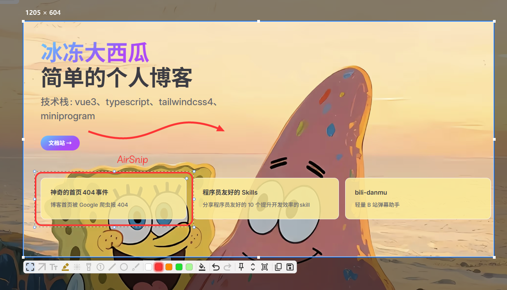

# AirSnip（轻截）

**2 MB 以内的截图标注工具，Windows 与 Linux（Wayland）双平台。** 待机不占 CPU、常驻内存个位数 MB、
按热键 0.1 秒级出画面——标注、二次编辑、长截图、贴图、多格式另存，功能一样不少。

> 纯 CPU 渲染，不依赖 GPU、不套 Electron、不装运行时。解压即用的绿色单文件，在核显迷你主机、虚拟机、远程桌面里同样流畅。
>
> **两套原生前端，共用同一份核心与绘制代码：** Windows 版（GDI + DirectWrite）与 Linux 版
> （Wayland `wlr-screencopy` + `wlr-layer-shell` + cosmic-text），标注对象模型、撤销栈、
> 矢量绘制逻辑都在 `airsnip-core` 里，两个平台行为一致。Linux 侧见 [Linux（Wayland）原生前端](#linuxwayland原生前端)。



*按 `F1` 后的样子：屏幕冻结、框选区域，底部一行就是全部标注工具。图中选中了一个矩形标注（可拖动 / 改色 / 删除），另有一条箭头。*

## 几条硬指标

| 指标 | 表现 | 说明 |
|---|---|---|
| **体积** | **单文件 < 2 MB** | 绿色免安装，一个 exe 就是全部（zip 包更小） |
| **待机内存** | **< 5 MB** | 常驻托盘时的 Private Working Set（实测 1 MB 量级） |
| **待机 CPU** | **0%** | 事件驱动、无定时轮询，不截图时完全不占 CPU |
| **热键 → 可用画面** | **≤ 150 ms** | 2560×1440：抓屏 + 暗化 + 覆盖层就绪（0.1 秒级） |
| **拖框重绘** | **≥ 60 FPS** | 每帧个位数毫秒，16.7 ms 预算留有多倍余量 |

> 截图会话期间会按屏幕大小临时分配位图（1440p 约 15 MB），退出覆盖层立即释放——不截图时它几乎不占资源。
> 以上为上限口径（不会随每次发版漂移）；精确数值与测量方法见 `docs/perf-m5.md`。

**为什么能这么小：** 没有 Electron / WebView / .NET 运行时，界面与标注全部由 Rust 直接绘制（tiny-skia 矢量栅格化 + DirectWrite 文字），抓屏走 GDI BitBlt，常驻部分只做「等热键」一件事。不少同类工具自带运行时或基于 Electron，安装包在数十至上百 MB、常驻内存数百 MB 量级——AirSnip 把安装包压到 2 MB 以内、常驻内存压到 1 MB 量级。

## 适合谁

- **经常截图写文档 / 提 bug 的人**：热键即出、标完直接粘，不用开大软件
- **老机器 / 迷你主机 / 虚拟机 / 远程桌面**：不靠 GPU、不吃内存，开机自启无感
- **不喜欢装东西的人**：一个 exe，删了就卸载干净，不写注册表（自启走任务计划）
- **在意隐私的人**：本地处理，不联网、不上传、无遥测

## 功能

### 截图
- `F1` 触发：全屏冻结 → 框选（八向缩放、按住空格整体拖动、方向键 1px 微调 / `Shift` 5px）
- 选区内空白处双击 = 复制完成，一步到位
- 截图过程中按 `Shift+F1` = **再次截图**：当前画面（含工具栏、选区与已有标注）当作新底图重新框选，
  用来截 AirSnip 自己的界面；该键只在截图期间生效，可在设置面板改。
  注意：已有的标注会被拍进新底图变成像素，不再可编辑（不可撤销）
- 多显示器与负坐标布局正确（Per-Monitor V2 感知；混合 DPI 见「已知限制」）

### 标注（10 个工具，箭头支持直线与曲线）
| 工具 | 能做什么 |
|---|---|
| 矩形 | 描边颜色、线宽、填充、**圆角** |
| 箭头 | 直线或曲线（三次贝塞尔），头部随线宽缩放；`Shift` 吸附水平 / 垂直 / 45° |
| 文本 | 中文输入法、系统全部字体、粗体 / 斜体、字号，双击再编辑 |
| 荧光笔 | 正片叠底半透明色块，不遮挡底图文字 |
| 高斯模糊 | 拖动区域即模糊，强度滚轮可调 |
| 聚光灯 | 选区内整体暗化、绘制区域恢复原亮，可叠加多块 |
| 序号标记 | 按下放圆形徽标（1、2、3…自动递增），拖出箭头指向目标；双击徽标可改编号 |
| 直线 | 无箭头纯线段，`Shift` 吸附水平 / 垂直 / 45° |
| 椭圆 | 拖出外接矩形画椭圆，可填充，`Shift` 画正圆 |
| 手绘 | 按住鼠标自由涂画，点列贝塞尔平滑，颜色 / 线宽可调 |

曲线箭头：选中后 1/3、2/3 处出现控制柄，拖出 S 形，双击恢复直线。
矩形、荧光笔、模糊、聚光灯都支持**圆角**：拖包围框内侧角的小圆柄即可，所见即所得。

### 二次编辑
- 选中对象显示包围框 + 八向手柄：拖动移动、拖角缩放（`Shift` 等比）
- 选中后按 `Del` / `Backspace` 只删这一个标注，`Ctrl+Z` 一步恢复，不连带撤销其它标注
- 鼠标在工具栏按钮上停约 0.4 秒，弹出「名称 · 快捷键」悬浮提示（改键后跟着变）
- 颜色与填充实时作用于选中对象，不用重画；线宽 / 模糊强度 / 字号用滚轮调，同样作用于选中对象
- `Shift` 约束：新建时正方形、箭头方向吸附，编辑时轴向锁定、等比缩放
- 撤销 / 重做 100 步，一次拖拽 = 一步，误操作随手回退

### 输出
- 剪贴板：`CF_DIB` + 延迟渲染 PNG，粘到微信 / 文档 / 聊天框都不失真
- 另存为：PNG / JPEG / WebP（无损），弹出系统对话框自选路径与格式
- 文件名模板：`airsnip-20241231-235959` / 时间戳 / 仅日期；记住上次目录与格式，连拍不打断

### OCR 文字识别
- 框选后按 `T` 或点工具栏「OCR」：覆盖层立刻关闭，弹出文字卡片
- 识别走 Windows 自带的 `Windows.Media.Ocr`——图片不出本机、不联网、不要 API key、不计费
- 卡片内可直接改错字：拖选、`Ctrl+A/C/V/X/Z`、右键菜单、输入法候选框跟随光标、长文本滚轮滚动
- 左下「复制」一键入剪贴板，右下「自动复制」开关（默认关）；顶部图钉把卡片置顶，方便对照粘贴；卡片不自动关闭，`Esc` 或 ✕ 收起
- 识别语言默认跟随系统首选，也可在设置里固定；缺语言包会明说缺哪个，不会静默出乱码
- 不需要「先开功能」：按钮默认就在（首次识别才初始化引擎，不识别时不占资源）；
  不想看到它就在设置 →「工具栏」里藏起来——藏起来后 `T` 仍可用

### 长截图
- 以当前选区为视口，自己滚动页面、`Enter` 收尾，`Ctrl+Z` 可撤销最后一段
- 全重叠区一致性校验拼接，自动识别固定页眉 / 页脚不重复
- 拼接过程实时缩略预览，滚到哪看到哪

### 贴图（Pin）
- `F3` 把选区（含标注）钉在屏幕上，随时对照
- 拖动、滚轮缩放、`Ctrl`+滚轮调透明度、1px 蓝框、右键菜单
- 最多 20 张，可一键全部关闭

### 设置
- 自绘面板，跟随系统深浅色
- **工具栏页**：把截图工具栏收成自己常用的那一小块——10 个工具 / 5 个色块 / 填充·撤销·重做·字体行 / 贴图·长截图·OCR / 复制·保存 逐项可隐，组头一键全显或全隐；
  隐藏只影响绘制，快捷键与输出照旧（藏了保存按钮，`Ctrl+S` 照样能存）
- 开机自启、全部快捷键改键（含冲突检测与输入法兼容）
- 贴图默认位置、文件名模板、主题
- 「关于」页：版本、许可、第三方组件清单、项目地址

## 快捷键

截图界面（覆盖层）：

| 按键 | 动作 |
|---|---|
| `Enter` / `Ctrl+C` / 选区内双击 | 复制到剪贴板并退出 |
| `Ctrl+S` | 另存为（PNG / JPEG / WebP） |
| `F3` | 把选区贴到屏幕 |
| `S` | 长截图（当前选区为视口，可改） |
| `Shift+F1` | 再次截图：把当前画面当作新底图重新框选（用于截取本软件界面，可改） |
| `T` | OCR 识别选区文字（可改，可在「工具栏」页隐藏按钮） |
| `1`–`9`、`0` | 切换工具（矩形 / 箭头 / 文本 / 荧光笔 / 模糊 / 聚光灯 / 序号 / 直线 / 椭圆 / 手绘，可改） |
| `Ctrl+Z` / `Ctrl+Y` · `Ctrl+Shift+Z` | 撤销 / 重做 |
| `Del` / `Backspace` | 删除选中的那个标注（一步撤销可恢复，不影响其它标注） |
| 方向键（`Shift` ×5） | 微调选中对象；无选中时移动选区框 |
| `Shift` + 拖动 | 正方形 / 箭头方向吸附 / 轴向锁定 / 等比缩放 |
| 按住空格 + 拖动 | 移动整个选区 |
| 滚轮 | 调线宽 / 模糊强度 / 字号（悬停对象或空白处） |
| `Esc` | 取消截图 |

贴图窗口：左键拖动、滚轮缩放、`Ctrl`+滚轮透明度、双击 / `Esc` 关闭、右键菜单、`Ctrl+F3` 边框开关、方向键移动。

全局热键默认 `F1` 截图、`F3` 贴图，可在设置面板修改（也支持 `PrtScn` 这类只发松键消息的系统键）；无修饰键会抢占其他程序按键，建议用 `Ctrl` / `Alt` 组合。
「再次截图」（默认 `Shift+F1`）只在截图过程中生效：按一下就把当前画面（含工具栏、选区、已有的标注）当作新底图重新框选，用来截 AirSnip 自己的界面。
鼠标中键与两个侧键可当截图 / 贴图 / 贴图边框键（Raw Input 订阅，不抢占其他程序）：不支持鼠标 + 修饰键组合，也无需担心按键被吞。

## 系统要求

### Windows

- **Windows 10 及以上（64 位）**；Windows 11 已实测。只提供 x64 构建。
- **Windows 7 / 8 / 8.1 无法运行**，且不是功能缺失——exe 在加载阶段就会被系统拒绝，双击后通常弹「无法定位程序输入点 WaitOnAddress 于动态链接库 KERNEL32.dll 上」或被提示缺少 `api-ms-win-core-synch-l1-2-0.dll`，进程起不来。

  原因：程序静态导入了 Windows 10 之前不存在的系统 API——`WaitOnAddress`（Windows 8 引入，Rust 标准库从 1.78 起用它做锁）、`GetDpiForMonitor`（8.1）、`GetDpiForWindow`（10 1607），以及 WinRT OCR 的 `RoInitialize` / `RoGetActivationFactory`（Windows 8 引入，而 `Windows.Media.Ocr` 只在 Windows 10 上存在）。这些是导入表里的必解析项，无法运行时降级；要在 Win7 上跑需要自行编译 Rust 标准库（tier-3 目标 `x86_64-win7-windows-msvc`）并砍掉 OCR，本项目不做这个取舍。完整原因与导入项清单见 [#94](https://github.com/bd-dxg/airsnip/issues/94)。

### Linux（Wayland）

- **wlroots 系协议的 Wayland 合成器**：niri / sway / Hyprland / KDE Plasma 6 已支持用例；
  niri 26.04 为本仓库的实测环境（双屏 1920×1080，实机验证）
- 需要 `wlr-screencopy`（抓屏）与 `wlr-layer-shell`（覆盖层）两个协议；
  缺协议时程序会明确报错，不会静默降级
- 剪贴板需要 `wl-clipboard`（`wl-copy` / `wl-paste`，主流发行版基本预装）；
  没装时退回内置驻留模式
- **不支持** GNOME Wayland（不提供上述协议，需 PipeWire + portal，属另一条实现路径）与 X11
- 无 GUI 运行时依赖：不装 GTK/Qt/Electron，字体走 fontconfig（中文需系统里有思源黑体或 Noto CJK）

## Linux（Wayland）原生前端

Windows 版之外，仓库里另有一个 **Linux 原生前端**（`crates/airsnip-linux`，ADR 0034），
面向 **wlroots 系协议族**的合成器：**niri / sway / Hyprland / KDE Plasma 6**。

- 不用 Wine、不用虚拟机：抓屏走 `wlr-screencopy`，覆盖层走 `wlr-layer-shell`，纯 CPU 渲染
- 热键交给合成器绑定（Wayland 没有全局热键协议），因此**没有常驻进程、没有托盘**
- **不做** GNOME Wayland（不支持上述协议）与 X11

当前进度（分阶段见 ADR 0034 §6）：

| 阶段 | 内容 | 状态 |
|---|---|---|
| S1 | `wlr-screencopy` 抓屏合成整屏底图（与 `grim` 逐像素一致） | ✅ 已交付 |
| S2 | 全屏覆盖层 + 框选 + `Enter` 复制 / `Ctrl+S` 保存 / `Esc` 取消 | ✅ 已交付 |
| S3 | 绘制层与 `airsnip-core` 打通（一份绘制代码两平台共用） | ✅ 已交付 |
| S4 | 10 种标注工具 + **工具栏**（工具 / 5 色块 / 填充 / 撤销 / 重做 / 复制 / 保存） | ✅ 已交付 |
| S4b | **文本工具 + 中文输入法**（text-input-v3） | ✅ 已交付 |
| S4c | **对象选中 / 移动 / 缩放 / 删除 / 方向键微调 / 滚轮线宽 / 颜色·填充作用于选中对象** | ✅ 已交付 |
| S4d | **选区尺寸提示、`Shift` 绘制约束、箭头曲率控制点、圆角手柄** | ✅ 已交付 |
| S5 | 贴图、长截图、OCR、多格式另存、设置面板 | ⬜ 未开始 |

**已交付的 Windows 版功能中，Linux 侧尚未移植的**：长截图、贴图（Pin）、OCR、设置面板、
多格式另存为、颜色/填充作用于选中对象（= 对象编辑）。

三种装法，任选其一：

```bash
# 1) AUR（含 Linux 前端的首个版本起可用，打包细节见 packaging/aur/README.md）
yay -S airsnip            # 或 paru -S airsnip → 装到 /usr/bin/airsnip

# 2) 官方打包脚本：产出 dist/airsnip-v<版本>-linux-x86_64.tar.gz + SHA256SUMS
scripts/package-linux.sh && tar xzf dist/airsnip-v*-linux-x86_64.tar.gz

# 3) 装到用户目录（不动系统目录，本机当前就是这么装的）
scripts/install-linux.sh  # 构建 release + 装到 ~/.local/bin/airsnip
```

日常命令：

```bash
airsnip snip                 # 截图：框选 → Enter 复制 / Ctrl+S 保存 / Esc 取消
airsnip capture -o a.png     # 只抓屏落 PNG（验证用）
```

卸载：删掉那个二进制即可（`/usr/bin/airsnip` 或 `~/.local/bin/airsnip`）——
不写全局配置、不装守护进程、不注册自启。

niri 的绑定（`~/.config/niri/config.kdl`）：

```kdl
binds {
    Mod+F1 { spawn "airsnip" "snip"; }   # 或写绝对路径 ~/.local/bin/airsnip
}
```

当前可用的键位（先在终端里试 `./target/release/airsnip snip`）：

| 键 | 作用 |
|---|---|
| 拖动 | 框选（选区内变亮） |
| **工具栏** | 选区下方单行：10 工具 / 5 色块 / 填充 / 撤销 / 重做 / 复制 / 保存（点图标即生效） |
| `1`–`9`、`0` | 切换工具：矩形 / 箭头 / 文本 / 荧光笔 / 模糊 / 聚光 / 序号 / 直线 / 椭圆 / 手绘 |
| 选区内拖动 | 用当前工具画标注 |
| `Shift` + 拖动 | 矩形/椭圆/高亮/模糊/聚光 → 正方形；箭头/直线 → 吸附水平/垂直/45° |
| **点一下已有标注** | 选中它（显示包围框 + 八向手柄） |
| `Ctrl` + 拖动标注 | 移动选中对象（不按 Ctrl 直接拖仍是画新标注） |
| 拖动包围框手柄 | 缩放（箭头 / 直线只有两端点手柄，拖动改端点） |
| 拖包围框**内侧右上角的小圆点** | 改圆角半径（朝中心拖变圆、朝角拖变直），矩形/高亮/模糊/聚光都支持 |
| 拖箭头的**两个小圆点** | 把箭头拉成曲线（虚线连到端点，S 形） |
| `Del` / `Backspace` | 删除选中对象（`Ctrl+Z` 一步恢复） |
| 方向键 / `Shift` + 方向键 | 微调选中对象 1px / 5px |
| 滚轮 | 调线宽（有选中对象时改它，否则改画笔） |
| 色块 / 填充 | 有选中对象时直接改它，否则作用于下一次绘制 |
| 文本工具：点一下 → 打字 → `Esc` 或点别处 | 中文走系统输入法（text-input-v3），无输入法时按键兜底 |
| `Ctrl+Z` / `Ctrl+Y` | 撤销 / 重做 |
| `Enter` / `Ctrl+C` | 复制选区（含标注） |
| `Ctrl+S` | 保存到 `$XDG_PICTURES_DIR/airsnip-<时间戳>.png` |
| `Esc` | 取消 |

复制走 **`wl-copy`**（`wl-clipboard` 包，Wayland 桌面基本必装）：AirSnip 把 PNG 交给它之后
立刻退出，由 `wl-copy` 常驻持有选区——与你桌面上其它截图工具（Flameshot / DMS quickCapture）
的行为一致。机器上没有 `wl-copy` 时退回内置驻留模式（AirSnip 自己持有选区，直到被顶掉）。

已知边界：保存固定写图片目录（无另存为对话框）、没有设置面板（工具/颜色的偏好不跨会话保存）、
文本对象还不能二次编辑（点上去是选中，不是改字）。

文本工具的两个实测细节：① **输入法会吃掉 `Enter`**（只回 `commit_string`），所以结束输入用
`Esc` 或点别处，`Enter` 只在没有输入法时生效；② 编辑态下按 `Esc` 是**提交**而不是丢弃
（避免输入被吞掉后无键可结束）。

## 下载与使用

1. 从 [Releases](https://github.com/bd-dxg/airsnip/releases) 下载 `airsnip-v*-win-x64.zip`，解压到任意目录（绿色单文件，无需安装）
2. 双击 `airsnip.exe`：程序**需要管理员权限**（否则无法覆盖管理员权限的窗口，见 ADR 0003），首次运行会弹 UAC，请选「是」
3. 启动后托盘常驻（无主窗口），按 `F1` 截图 / `F3` 贴图
4. 托盘左键打开设置，右键为「设置 / 退出」
5. 配置位置：`%APPDATA%\airsnip\config.toml`

**自动更新**：启动后 3 秒静默检查一次新版本（可在设置 → 关于页关闭），发现新版本时弹托盘气泡提示；到「关于 → 版本更新」点一下即可下载并自动替换重启。清单与安装包优先走国内加速镜像，GitHub 直连兜底；清单用 ed25519 签名 + SHA-256 校验，验签不过不会安装。

**首次运行提示**：exe 未做代码签名，Windows SmartScreen 可能提示「已保护你的电脑」——点「更多信息」→「仍要运行」。

**从旧版 `jietu`（v0.5.0 及更早）升级**：本版改名为 AirSnip，**不做自动迁移**，请手动完成三件事——
1. 删除旧的开机自启任务（管理员 PowerShell）：`schtasks /delete /tn jietu /f`
2. 退出并删除旧版 `jietu.exe`：新旧版的单实例互不排斥，同时运行会抢同一组热键
3. 设置需重设一次（新配置在 `%APPDATA%\airsnip\config.toml`）；旧截图仍在 `图片\jietu`，不会自动搬家

## 构建与开发

```powershell
cargo run                 # 开发版（不提权，可调试）
cargo build --release     # 发布版（manifest 要求管理员权限，单文件）
cargo test                # 单测（364 项，另 15 项需 --ignored 手动触发）
cargo fmt --check         # 格式化检查
cargo deny check          # 依赖许可证 / 安全公告 / 来源检查
pwsh scripts/package.ps1  # 打包 dist\airsnip-v{版本}-win-x64.zip / .exe
pwsh scripts/gen-latest-json.ps1 -Notes "说明"  # 生成并签名自动更新清单 latest.json
```

Linux 前端：

```bash
cargo build -p airsnip-linux --release   # 产物 target/release/airsnip
cargo test -p airsnip-core -p airsnip-linux
scripts/package-linux.sh                 # → dist/airsnip-v<版本>-linux-x86_64.tar.gz + SHA256SUMS
```

CI（`.github/workflows/linux.yml`）：ubuntu-latest 上跑 `cargo fmt` / `cargo deny check` /
单测 / release 打包并上传 artifact。**不要**用 `cargo build --workspace`：两个 bin 都叫
`airsnip`，会撞产物名，且 Windows 前端在 Linux 上编不过。

技术栈：Rust 1.98（edition 2024）、windows-rs 0.62、tiny-skia 0.12（矢量栅格化）、DirectWrite（文字）、serde / toml、png / jpeg-encoder / image-webp。MSVC 运行时**静态链接**，exe 不依赖 VC++ Redistributable。当前版本 v0.11.0。

## 已知限制

- 发布版以管理员权限运行（覆盖 / 操作管理员窗口需要，见 ADR 0003）；开机自启走任务计划而非注册表
- 独占全屏游戏、DRM 保护内容可能抓到黑屏（系统限制，非本程序可绕过）
- 界面仅简体中文，代码层预留 i18n
- 多屏混合 DPI 尚未在实机验证（无环境）；单屏与负坐标多屏已实测正常
- 极端组合下工具栏可能比屏幕还宽（例如 1366×768 配 200% 界面缩放），右侧按钮会被裁掉一角；
  到设置 →「工具栏」里隐藏不用的元素即可恢复（快捷键始终不受影响，ADR 0033）

## 文档

- `screenshot-tool-PRD.md` — 完整需求与技术方案（性能红线、风险对策）
- `docs/adr/` — 架构决策记录
- `docs/release-notes/` — 各版本发布说明
- `docs/perf-m5.md` — 性能实测数据与优化过程
- `THIRD-PARTY.md` — 第三方组件声明

## 许可

[GPL-3.0-only](LICENSE)。源文件均带 SPDX 标注；依赖均为宽松许可证（MIT / Apache-2.0 / BSD / Zlib / IJG 等），与 GPL-3.0 兼容。

感谢 [LinuxDo](https://linux.do/) 社区
